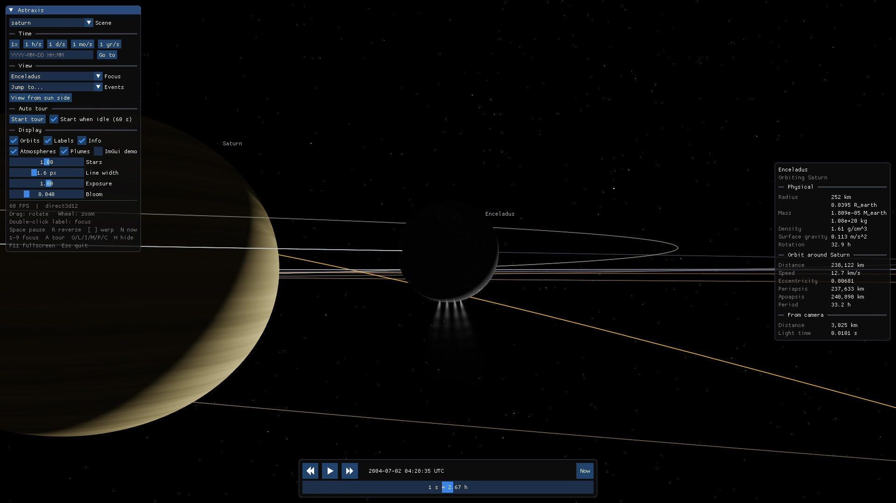

<br />
<div align="center">
  
  <h3 align="center">Astraxis</h3>
  
  
</div>
<br />

Astraxis is an astronomy background app with planets, spacecraft and stars animated from orbital data and physical simulations. Run it in a window or full screen, or use it as a live wallpaper or screensaver on Windows.

## Scenes

| Scene | Highlights |
|---|---|
| Solar System (default) | Planets, moons, dwarf planets, asteroids and interstellar objects |
| Jupiter | Rings and moons, Galileo and Juno orbits, Cassini flyby |
| JWST | Halo orbit around Sun-Earth L2 |
| Earth-Moon | Artemis missions, CAPSTONE and other lunar spacecraft |
| Saturn | Rings, major moons, retrograde Phoebe, Cassini's tour and Huygens' descent |
| Mercury: MESSENGER & BepiColombo | Gravity assists and orbits around Mercury |
| Venus | Venus Express, Akatsuki, Zoozve and spacecraft flybys |
| Mars | Phobos, Deimos, eight orbiters, comet Siding Spring and interstellar comet 3I/ATLAS |
| Rosetta & 67P | Journey to comet 67P, Rosetta's orbits and Philae's landing |
| ISEE-3 / ICE | L1 halo orbit, lunar flybys and comet encounters |
| Parker Solar Probe | Venus gravity assists and close passes of the Sun |
| Alpha Centauri | A, B and Proxima in an N-body simulation |
| Sgr A* | Ray-traced Galactic Centre black hole and orbiting S-stars |
| TRAPPIST-1 | Seven Earth-sized planets in a resonant chain |
| Kepler-223 | Four sub-Neptunes in a 3:4:6:8 resonant chain |
| Kepler-47 | Three planets orbiting an eclipsing binary |
| Kepler-64 / PH1 | A planet in a four-star system |
| TIC 168789840 | Six stars in three eclipsing binaries |
| Algol | The "demon star": an eclipsing triple, with its light curve as seen from Earth |
| Delta Cephei | The prototype Cepheid pulsating every 5.37 days, and its eccentric companion |
| PSR B1620-26 | A pulsar, white dwarf and planet in the M4 cluster |
| PSR B1913+16 (Hulse-Taylor) | Binary neutron stars with relativistic orbital precession |
| PSR J1141-6545 | A pulsar and white dwarf with relativistic orbital precession |

Add scenes with TOML files in [assets/scenes](assets/scenes/). These files cite the orbital data and physical constants. Data licenses are listed in `assets/*/SOURCES.md`; modeling assumptions are documented in [limitations.md](limitations.md).

## Preview

<a href="screenshots/demo_saturn.jpg">
    
</a>

## Download

- [Latest Release](https://github.com/a1ive/Astraxis/releases/latest)
- [Nightly Builds](https://github.com/a1ive/Astraxis/actions/workflows/build.yml)

## Building

CMake downloads pinned versions of SDL3, glm, Dear ImGui, toml++, stb_image and Microsoft's DirectX Shader Compiler. The shader compiler builds HLSL shaders as DXIL and SPIR-V.

### Windows (Direct3D 12)

Use Visual Studio 2026 with its bundled CMake.

```bash
cmake --preset win-msvc
cmake --build --preset win-msvc-debug
```

Run the app with `build/win-msvc/Debug/astraxis.exe` and the unit tests with `build/win-msvc/Debug/astraxis_tests.exe`. The build also places `astraxis.scr` (the screensaver) and `astraxis_wallpaper.exe` (the wallpaper launcher and settings dialog) next to `astraxis.exe`.

Windows MSVC builds use [VC-LTL5 v5.3.1](https://github.com/Chuyu-Team/VC-LTL5/tree/v5.3.1) for non-Debug configurations to reduce the runtime footprint. Debug uses the standard Debug CRT. Set `-DASTRAXIS_USE_VC_LTL=OFF` to disable VC-LTL, or pass `-DASTRAXIS_USE_VC_LTL=ON` to enable it in an existing build directory.

To build and test the CI Release configuration locally:

```bash
cmake --preset win-msvc -B build/win-vcltl -DASTRAXIS_USE_VC_LTL=ON -DCMAKE_MSVC_RUNTIME_LIBRARY=MultiThreaded
cmake --build build/win-vcltl --config Release
ctest --test-dir build/win-vcltl -C Release --output-on-failure
```

### Linux x64 (Vulkan)

Use GCC or Clang with C++20 support, CMake 3.28 or later, Ninja and the X11/Wayland development headers required by SDL3. On Ubuntu:

```bash
sudo apt install ninja-build libx11-dev libxext-dev libxrandr-dev libxcursor-dev libxi-dev libxss-dev libxtst-dev libxfixes-dev libxkbcommon-dev libwayland-dev libdecor-0-dev libdrm-dev libgbm-dev libegl-dev
cmake --preset linux
cmake --build --preset linux-release
```

Run the app with `build/linux/Release/astraxis` and the unit tests with `build/linux/Release/astraxis_tests`. The app needs a Vulkan driver.

The Windows build includes SPIR-V shaders too. Set `SDL_GPU_DRIVER=vulkan` to run it on Vulkan.

## Command line

```bash
astraxis --scene sgr_a --event 1
```

| Option | Meaning |
|---|---|
| `--scene <name>` | A file from `assets/scenes/`, without `.toml` (default: `solar_system`) |
| `--event <n>` | Start at an entry of the scene's Events list, numbered from 1 |
| `--mode <mode>` | `window` (default), `fullscreen`, `screensaver` or `wallpaper` (Windows) |
| `--display <n>` | The display to use, numbered from 1 |
| `--fps <n>` | Frame rate cap (0: the display's refresh rate) |
| `--config <path>` | Use a settings file other than `config.toml` |

Command-line options apply to the current run and leave saved settings unchanged.

## Settings

Settings are stored in `config.toml` next to the executable. The window saves panel changes when it closes. Wallpaper and screensaver settings have separate sections, edited through their settings dialogs, and inherit display options they do not override. Saving requires a writable folder.

Under *Performance*, lower *Antialiasing* from the default 4x MSAA to 2x or off, or set *Resolution* to 75% or 50% for faster, softer rendering. A frame rate cap also reduces power use.

## Wallpaper and screensaver (Windows)

Both run on Windows 10 and Windows 11.

### Live wallpaper

Run `astraxis_wallpaper.exe`, choose a scene and displays, and click Apply. Use the notification-area icon to open settings, pause or stop. Enable *Start with Windows* to launch at sign-in. The wallpaper recovers after Explorer restarts or displays change; stopping it restores the Windows wallpaper.

### Screensaver

Right-click `astraxis.scr` and choose *Install*. Keep it beside `astraxis.exe` and the `assets` folder so it can find its resources. Open *Settings* in Windows' Screen Saver Settings dialog to configure it.

### Power use

The wallpaper pauses rendering while the session is locked or the display is off. It also pauses on individual displays covered by a maximized or full-screen window. Both settings dialogs offer resolution and frame rate controls, plus battery and battery-saver options: keep running, cap at 30 FPS (default), or pause.

## Controls

The auto tour switches views and visits events in time order, slowing down for flybys and showing captions. In wallpaper and screensaver mode, turn off *Event captions* in settings to hide them.

| Input | Action |
|---|---|
| Left/right drag | Rotate camera |
| Mouse wheel | Zoom |
| `1` to `9` | Focus on a body |
| `Space` | Pause / resume |
| `R` | Reverse time |
| `[` / `]` | Halve / double time warp |
| `N` | Jump to the current time |
| `A` | Toggle auto tour (starts by itself after 60 s idle) |
| `O` / `L` / `I` | Toggle orbits / labels / the focused body's info panel |
| `E` | Hide or show the current event's caption |
| `P` | Toggle the volcanic and cryovolcanic plumes (Io, Enceladus, Triton) |
| `M` | Toggle atmospheres |
| `C` | Toggle comet comae and tails |
| `H` / `F1` | Toggle UI |
| `F11` | Toggle full screen |
| `Esc` | Quit |

## License

Astraxis is licensed under the [GNU General Public License v3.0 or later](LICENSE) (GPL-3.0-or-later).

Third-party libraries and data have their own licenses. See [THIRD_PARTY_NOTICES.md](THIRD_PARTY_NOTICES.md).
