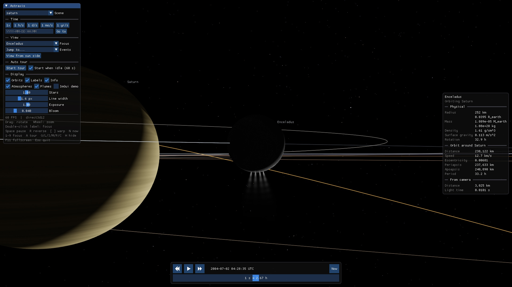

<br />
<div align="center">
  
  <h3 align="center">Astraxis</h3>
  
  
</div>
<br />

Astraxis is an astronomy background app with planets, spacecraft and stars animated from orbital data and physical simulations. Run it in a window or full screen, or use it as a live wallpaper or screensaver on Windows.

## Scenes

| Scene | Highlights |
|---|---|
| Solar System (default) | Planets, moons, dwarf planets, asteroids and interstellar visitors |
| Jupiter | Galileo and Juno, Shoemaker–Levy 9's breakup and impacts, and UV auroras with moon footprints |
| Space Telescopes | Observatories in Earth orbit, near L2 and trailing Earth |
| Earth-Moon | Artemis and CAPSTONE, city lights and auroras from historical Kp records |
| Saturn | Rings, Janus and Epimetheus swapping orbits, Cassini, Huygens and polar auroras |
| Uranus | Eccentric rings, Voyager 2's flyby, a tilted magnetic field and seasonal infrared glow |
| Neptune | Voyager 2, dark spots, Adams ring arcs, Triton's plumes and infrared aurora |
| Trans-Neptunian Objects | Neptune's Trojans and resonant, classical, scattered and detached objects, with resonances seen in Neptune's turning frame |
| Mercury: MESSENGER & BepiColombo | Gravity assists and orbits around Mercury |
| Venus | Venus Express, Akatsuki, Zoozve and spacecraft flybys |
| Mars | Phobos and Deimos, Mars orbiters, and comets Siding Spring and 3I/ATLAS |
| Rosetta & 67P | Rosetta's comet rendezvous and Philae's landing |
| DART & Didymos | DART's impact, LICIACube's flyby and Dimorphos's orbit without the impact |
| ISEE-3 / ICE | L1 halo orbit, lunar flybys and comet encounters |
| Parker Solar Probe | Venus flybys, close solar passes and an enhanced white-light corona |
| Solar eclipses | 2017 and 2024 eclipses above Earth, and Earth's red rim from near the Moon in 2022 |
| Alpha Centauri | Three-star dynamics and Proxima's 2016 superflare |
| Beta Pictoris | Edge-on debris disks, two planets, Webb's cat's tail and modeled comet transits |
| Sgr A* | Ray-traced Galactic Centre black hole and orbiting S-stars |
| Gargantua (Interstellar) | The film's black hole and Endurance with its rotating ring |
| Kerbol System (Kerbal Space Program) | The game's planetary system, orbits and calendar |
| PDS 70 | Two growing planets in a disk gap, with a moon-forming disk around c |
| HD 206893 | A gapped debris belt, two substellar companions and a candidate moon |
| TRAPPIST-1 | Seven Earth-sized planets in a resonant chain |
| Kepler-223 | Four sub-Neptunes in a 3:4:6:8 resonant chain |
| Kepler-47 | Three planets orbiting an eclipsing binary |
| Kepler-64 / PH1 | A planet in a four-star system |
| TIC 168789840 | Six stars in three eclipsing binaries |
| Castor | A six-star system with nearly perpendicular orbits, YY Gem eclipses and flares |
| Algol | An eclipsing triple with its light curve as seen from Earth |
| Beta Lyrae A | A distorted donor star, an opaque accretion disk and two eclipses |
| Delta Cephei | The prototype Cepheid, with a 5.37-day pulse and an eccentric companion orbit |
| Polaris | The North Star's 3.97-day pulse and two companions |
| WR 104 | A Wolf-Rayet binary with a rotating dust pinwheel |
| WR 140 | Nested dust shells from successive close passes of a Wolf-Rayet binary |
| Eta Carinae | The expanding Homunculus, fossil wind shells and a light curve dating to the 1820s |
| PSR B1620-26 | A pulsar, white dwarf and planet in the M4 cluster |
| PSR B1913+16 (Hulse-Taylor) | Binary neutron stars with relativistic orbital precession |
| PSR J1141-6545 | A pulsar and white dwarf with relativistic orbital precession |

Add scenes with TOML files in [assets/scenes](assets/scenes/). Shared body properties use [Body Templates](assets/bodies/README.md). Scene and template files cite the orbital data and physical constants. Data licenses are listed in `assets/*/SOURCES.md`; modeling assumptions are documented in [limitations.md](limitations.md).

The Jupiter and Saturn scenes each have two polar aurora events. The **Planetary aurora** control selects the event setting, visible light, or a UV and infrared false-color overlay on visible-light surfaces. Jupiter uses statistical Juno-UVS contours and modeled satellite footprints. Saturn uses Cassini UVIS statistical ovals, with a brighter, narrower dawn sector and attenuation through its rings. The Jupiter scene also has leading and trailing Ganymede aurora views, using the 1998-2017 HST oxygen-emission map. Colors and exposure are illustrative; the event dates do not identify recorded auroral images. Io and Callisto have visible aurora eclipse tours: Io uses measured oxygen, sodium and sulfur lines, while Callisto uses only the detected red oxygen doublet. Their assumed emitting layers have separate display gains. Europa also has a visible oxygen-aurora eclipse tour, using measured optical line strengths with an assumed smooth atmosphere and enhanced exposure. Mars has two green-line events: Perseverance's detection in March 2024, and the storm of September 2017, whose timing and height follow MAVEN's ultraviolet record and whose green line is inferred. See [sources and model limits](assets/geomag/SOURCES.md).

## Preview

<a href="screenshots/demo_saturn.jpg">
    
</a>

## Download

- [Latest Release](https://github.com/a1ive/Astraxis/releases/latest)
- [Nightly Builds](https://github.com/a1ive/Astraxis/actions/workflows/build.yml)

## Building

CMake downloads pinned versions of SDL3, glm, Dear ImGui, toml++, stb_image and Microsoft's DirectX Shader Compiler. The shader compiler builds HLSL shaders as DXIL and SPIR-V.

### Windows (Direct3D 12)

Use Visual Studio 2026 with its bundled CMake.

```bash
cmake --preset win-msvc
cmake --build --preset win-msvc-debug
```

Run the app with `build/win-msvc/Debug/astraxis.exe` and the unit tests with `build/win-msvc/Debug/astraxis_tests.exe`. The build also places `astraxis.scr` (the screensaver) and `astraxis_wallpaper.exe` (the wallpaper launcher and settings dialog) next to `astraxis.exe`.

Windows MSVC builds use [VC-LTL5 v5.3.1](https://github.com/Chuyu-Team/VC-LTL5/tree/v5.3.1) for non-Debug configurations to reduce the runtime footprint. Debug uses the standard Debug CRT. Set `-DASTRAXIS_USE_VC_LTL=OFF` to disable VC-LTL, or pass `-DASTRAXIS_USE_VC_LTL=ON` to enable it in an existing build directory.

To build and test the CI Release configuration locally:

```bash
cmake --preset win-msvc -B build/win-vcltl -DASTRAXIS_USE_VC_LTL=ON -DCMAKE_MSVC_RUNTIME_LIBRARY=MultiThreaded
cmake --build build/win-vcltl --config Release
ctest --test-dir build/win-vcltl -C Release --output-on-failure
```

### Linux x64 (Vulkan)

Use GCC or Clang with C++20 support, CMake 3.28 or later, Ninja and the X11/Wayland development headers required by SDL3. On Ubuntu:

```bash
sudo apt install ninja-build libx11-dev libxext-dev libxrandr-dev libxcursor-dev libxi-dev libxss-dev libxtst-dev libxfixes-dev libxkbcommon-dev libwayland-dev libdecor-0-dev libdrm-dev libgbm-dev libegl-dev
cmake --preset linux
cmake --build --preset linux-release
```

Run the app with `build/linux/Release/astraxis` and the unit tests with `build/linux/Release/astraxis_tests`. The app needs a Vulkan driver.

The Windows build includes SPIR-V shaders too. Set `SDL_GPU_DRIVER=vulkan` to run it on Vulkan.

## Command line

```bash
astraxis --scene sgr_a --event 1
```

| Option | Meaning |
|---|---|
| `--scene <name>` | A file from `assets/scenes/`, without `.toml` (default: `solar_system`) |
| `--event <n>` | Start at an entry of the scene's Events list, numbered from 1 |
| `--mode <mode>` | `window` (default), `fullscreen`, `screensaver` or `wallpaper` (Windows) |
| `--display <n>` | The display to use, numbered from 1 |
| `--fps <n>` | Frame rate cap (0: the display's refresh rate) |
| `--config <path>` | Use a settings file other than `config.toml` |

Command-line options apply to the current run and leave saved settings unchanged.

## Settings

Settings are stored in `config.toml` next to the executable. The window saves panel changes when it closes. Wallpaper and screensaver settings have separate sections, edited through their settings dialogs, and inherit display options they do not override. Saving requires a writable folder.

Under *Performance*, lower *Antialiasing* from the default 4x MSAA to 2x or off, or set *Resolution* to 75% or 50% for faster, softer rendering. A frame rate cap also reduces power use.

## Wallpaper and screensaver (Windows)

Both run on Windows 10 and Windows 11.

### Live wallpaper

Run `astraxis_wallpaper.exe`, choose a scene and displays, and click Apply. Use the notification-area icon to open settings, pause or stop. Enable *Start with Windows* to launch at sign-in. The wallpaper recovers after Explorer restarts or displays change; stopping it restores the Windows wallpaper.

### Screensaver

Right-click `astraxis.scr` and choose *Install*. Keep it beside `astraxis.exe` and the `assets` folder so it can find its resources. Open *Settings* in Windows' Screen Saver Settings dialog to configure it.

### Power use

The wallpaper pauses rendering while the session is locked or the display is off. It also pauses on individual displays covered by a maximized or full-screen window. Both settings dialogs offer resolution and frame rate controls, plus battery and battery-saver options: keep running, cap at 30 FPS (default), or pause.

## Controls

The auto tour switches views and visits events in time order, slowing down for flybys and showing captions. In wallpaper and screensaver mode, turn off *Event captions* in settings to hide them.

| Input | Action |
|---|---|
| Left/right drag | Rotate camera |
| Mouse wheel | Zoom |
| `1` to `9` | Focus on a body |
| `Space` | Pause / resume |
| `R` | Reverse time |
| `[` / `]` | Halve / double time warp |
| `N` | Jump to the current time |
| `A` | Toggle auto tour (starts by itself after 60 s idle) |
| `O` / `L` / `I` | Toggle orbits / labels / the focused body's info panel |
| `E` | Hide or show the current event's caption |
| `P` | Toggle the volcanic and cryovolcanic plumes (Io, Enceladus, Triton) |
| `M` | Toggle atmospheres |
| `B` | Toggle magnetic field lines |
| `G` | Cycle the magnetic field map (event setting, surface, deep, crust) |
| `C` | Toggle comet comae and tails |
| `H` / `F1` | Toggle UI |
| `F11` | Toggle full screen |
| `Esc` | Quit |

## License

Astraxis is licensed under the [GNU General Public License v3.0 or later](LICENSE) (GPL-3.0-or-later).

Third-party libraries and data have their own licenses. See [THIRD_PARTY_NOTICES.md](THIRD_PARTY_NOTICES.md).
